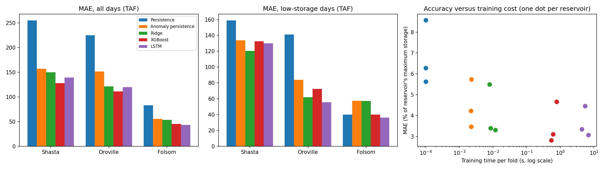

# 30-Day-Ahead Storage Forecasting for Three California Water-Supply Reservoirs

A small, reproducible study that compares simple and complex models for forecasting **reservoir storage 30 days ahead**, and asks what the extra accuracy costs in compute (time and memory). The structure mirrors my weather forecasting pilot project.

## Question
Do weather-driven machine learning models forecast reservoir storage better than strong seasonal baselines, and what does that cost?

## Data
- **Reservoir storage:** daily storage (acre-feet) for Shasta, Oroville and Folsom from the California Data Exchange Center (CDEC, California Department of Water Resources), 1990-01-01 to 2024-12-31.
- **Weather:** daily temperature, precipitation, snowfall and evapotranspiration at a point near each reservoir, from the Open-Meteo historical weather API (ERA5-based). Weather data by [Open-Meteo.com](https://open-meteo.com/).
- Raw data are not included in this repository; the notebook downloads them.

## Method
- **Target:** storage 30 days after the last observation (thousand acre-feet, TAF).
- **Features (13):** current storage, 7- and 30-day storage change, rainfall over 7/30/90 days, snowfall over 30/90 days, temperature over 7/30 days, 30-day evapotranspiration, day-of-year sin/cos. All features use data up to day t only.
- **Validation:** expanding-window time series cross-validation, 5 folds, 3-year test windows (about 2010-2024), 30-day gap between training and test. Climatology, scaling and the low-storage threshold are fitted on training data only.
- **Low-storage days:** test days whose departure from the seasonal normal is at or below the 10th percentile of training departures.
- **Models:** Persistence; Climatology; **Anomaly persistence** (seasonal normal in 30 days, shifted by today's departure from normal); Ridge; XGBoost; LSTM. The learned models predict the 30-day *change* in storage.
- **Cost:** training time, prediction time and peak RAM per fold (CPU runtime, 2 cores, 13.6 GB RAM, no GPU).

## Results (mean over 5 folds)

MAE in TAF (and as % of the reservoir's maximum observed storage):

| Model | Folsom | Oroville | Shasta |
|---|---|---|---|
| Persistence | 83.2 (8.6%) | 224.9 (6.3%) | 255.1 (5.6%) |
| Climatology | 129.0 (13.3%) | 592.8 (16.6%) | 739.2 (16.3%) |
| Anomaly persistence | 55.7 (5.7%) | 151.4 (4.2%) | 157.3 (3.5%) |
| Ridge | 53.3 (5.5%) | 121.3 (3.4%) | 150.1 (3.3%) |
| XGBoost | 45.3 (4.7%) | **111.3 (3.1%)** | **127.8 (2.8%)** |
| LSTM | **43.3 (4.5%)** | 119.7 (3.3%) | 139.5 (3.1%) |

Compute cost per fold (CPU):

| Model | Training | Prediction |
|---|---|---|
| Ridge | 8-12 ms | about 2 ms |
| XGBoost | 0.5-0.8 s | 10-13 ms |
| LSTM | 4.4-6.8 s | 22-23 ms |

### Findings
1. **XGBoost and the LSTM beat the best baseline (anomaly persistence) in 5 of 5 folds at all three reservoirs**, with 11-26% lower MAE.
2. **XGBoost beats Ridge in 5, 4 and 5 of 5 folds** (Folsom, Oroville, Shasta), suggesting the weather-storage relationship is partly nonlinear.
3. **XGBoost and the LSTM are close**: the LSTM beats XGBoost in only 3, 1 and 1 of 5 folds, so I do not claim either is more accurate. The LSTM costs about 7-13 times more to train.
4. **Dry periods remain hard.** On low-storage days no model beats the baselines consistently, and all learned models tend to overpredict storage (positive bias), meaning forecasts are too optimistic when water is scarce.

## Limitations
- The three reservoirs share regional weather, so they are not independent tests.
- Weather is taken at one point near each reservoir, not averaged over the upstream catchment; no snowpack or inflow data are used.
- Reservoir operations (releases for irrigation, flood control, power) are not modelled.
- Storage is total reservoir storage, not drinking water alone.

## Next steps
Upstream catchment weather and snow water equivalent, observed inflows, hyperparameter tuning with equal budgets for all models, uncertainty estimates, and a drought-focused evaluation.

## Reproduce
Run the notebook top to bottom in Google Colab (CPU runtime). No API key is needed.

## Author
Nisa, Mathematics and Computer Science.
